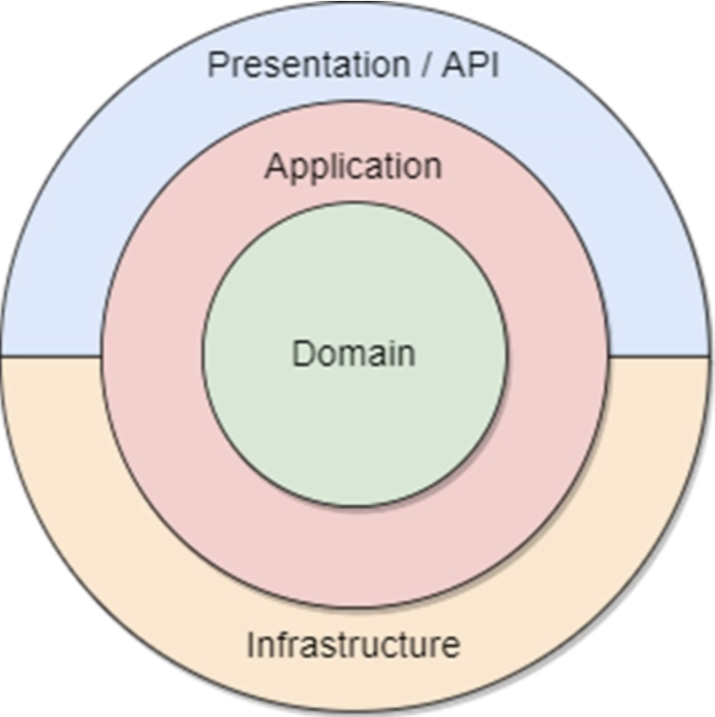

# CLT BOOTCAMP NOV - 2026

Spanish :

    Products CQRS: API de productos en .NET 10 con Clean Architecture y CQRS, PostgreSQL y nginx, todo en Docker.

    Primero se copia .env.example a .env y se completa la clave POSTGRES_PASSWORD. Ahí están todas las variables.

    Para correr todo: docker compose up -d --build y se abre http://localhost/scalar
    Para desarrollar: docker compose up -d db y después dotnet run --project src/ProductsCqrs.Api (http://localhost:5280/scalar)

    Cada IP puede hacer 50 lecturas y 1 escritura (crear, editar o borrar) por día. Los números se cambian en el .env.

    Demo funcional : https://products.fatecha.com.py

English :

    Products CQRS: A .NET 10 product API built using Clean Architecture and CQRS, with PostgreSQL and Nginx—all containerized via Docker.

    First, copy `.env.example` to `.env` and provide a value for the `POSTGRES_PASSWORD` key. All necessary variables are defined there.

    To run the entire setup: execute `docker compose up -d --build` and access `http://localhost/scalar`.
    For development: run `docker compose up -d db`, then execute `dotnet run --project src/ProductsCqrs.Api` (available at `http://localhost:5280/scalar`).

    Each IP address is limited to 50 read operations and 1 write operation (create, edit, or delete) per day. These limits can be adjusted in the `.env` file.

    Functional demo: https://products.fatecha.com.py

## Capas / Layers

Spanish :

**Domain** — las reglas del negocio, no depende de nadie.\
Ej: `Product` (con sus validaciones) e `IProductRepository`.

**Application** — los casos de uso: orquesta el dominio (los comandos escriben, las consultas leen).\
Ej: `CreateProductCommand` con su handler y su validator, y `GetProductQuery`.

**Infrastructure** — implementa las interfaces y habla con el exterior.\
Ej: `ProductRepository` y `ProductReadStore` con EF Core y PostgreSQL.

**Presentation / API** — la puerta de entrada: recibe y responde.\
Ej: `ProductEndpoints` (Minimal API), manejo de errores y límite por IP.

Regla: las dependencias apuntan hacia adentro. Domain no conoce a nadie.

English :

**Domain** — the business rules, depends on nothing.\
Ex: `Product` (with its validations) and `IProductRepository`.

**Application** — the use cases: orchestrates the domain (commands write, queries read).\
Ex: `CreateProductCommand` with its handler and validator, and `GetProductQuery`.

**Infrastructure** — implements the interfaces and talks to the outside world.\
Ex: `ProductRepository` and `ProductReadStore` using EF Core and PostgreSQL.

**Presentation / API** — the entry point: receives requests and responds.\
Ex: `ProductEndpoints` (Minimal API), error handling and per-IP limits.

Rule: dependencies point inward. Domain knows nothing about the other layers.
